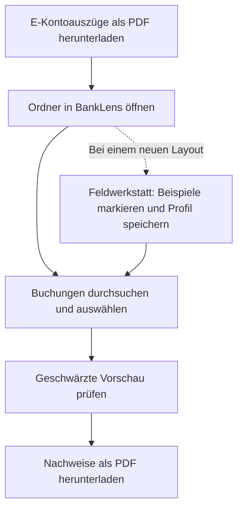

# BankLens

**Zahlungsnachweise aus deinen Kontoauszügen – lokal filtern, auswählen und schwärzen.**

Du brauchst mehrere Zahlungen für eine Abrechnung, eine Erstattung oder einen anderen Anlass? BankLens durchsucht deine heruntergeladenen E-Kontoauszüge und erstellt PDF-Kopien, in denen die ausgewählten Buchungen sichtbar bleiben und andere Buchungen geschwärzt sind. Die Verarbeitung läuft auf deinem Rechner.

## Warum BankLens?

Eine einzelne Zahlungsbestätigung lässt sich in vielen Banking-Apps noch recht einfach abrufen. Mehrere Zahlungen für denselben Anlass zusammenzustellen, wird schnell umständlich: Buchungen suchen, Belege einzeln öffnen und jede Bestätigung separat exportieren. Bei älteren Zahlungen kommt hinzu, dass die benötigten Details nicht mehr vollständig verfügbar sind.

Aus eigener Erfahrung mit Bank Austria: Die Umsatzhistorie reicht zwei Jahre zurück, vollständige Belegdaten einschließlich Zahlungsgrund sind jedoch nur für sechs Monate abrufbar. Diese Beobachtung beschreibt den Ausgangspunkt des Projekts; die Verfügbarkeit kann sich je nach Banking-Angebot ändern.

E-Kontoauszüge sind länger verfügbar: Bank Austria nennt dafür einen Zeitraum von sieben Jahren. Sie enthalten viele der Angaben, die für einen Zahlungsnachweis benötigt werden. BankLens macht diese vorhandenen PDFs durchsuchbar und hilft dir, die relevanten Buchungen gesammelt weiterzugeben. [Quelle: Bank Austria](https://www.bankaustria.at/mobile-banking-app-funktionen.jsp)

## Was ist BankLens?

BankLens ist eine lokale Anwendung zum Filtern und Schwärzen von E-Kontoauszügen im PDF-Format. Du verwendest die Kontoauszüge, die du bereits von deiner Bank heruntergeladen und auf deinem PC gespeichert hast. Zusätzliche Umsatz- oder Belegexporte sind nicht nötig.

Du suchst darin nach den gewünschten Zahlungen und erstellst daraus geschwärzte PDF-Kopien für deinen Anlass. Die Bedienung erfolgt im Browser, die Verarbeitung vollständig auf deinem Rechner: BankLens braucht keinen Zugang zu deiner Banking-App oder deinem Onlinebanking und lädt keine Kontoauszüge in eine Cloud hoch.

**BankLens verwendet zur Verarbeitung deiner Kontoauszüge keine KI.**[^ki-entwicklung] Die Erkennung arbeitet regelbasiert mit Text und Positionen aus den PDFs. In der Feldwerkstatt ergänzt du Layoutregeln durch markierte Beispiele; dafür werden weder KI-Modelle noch externe Dienste benötigt.

## Vom Kontoauszug zum Nachweis



BankLens ist zunächst für textbasierte E-Kontoauszüge von Bank Austria entwickelt. Über die **Feldwerkstatt** lassen sich weitere Layouts anhand von Beispielen anlernen, ohne Programmcode zu ändern. Die Erkennung anderer Banken muss mit deren Auszügen geprüft werden.

## Starten

Du brauchst Python 3.11 oder neuer und einen Browser. Lade das Repository herunter oder klone es:

```sh
git clone https://github.com/cip/BankLens.git
cd BankLens
```

Richte einmalig die Python-Umgebung ein:

```sh
python3 -m venv .venv
. .venv/bin/activate
python -m pip install -r requirements.txt
```

Starte BankLens:

```sh
sh tools/pdf-toolkit preview
```

Öffne die im Terminal angezeigte lokale URL im Browser und wähle dort deinen Auszugsordner. Du kannst den Ordner alternativ beim Start als Argument angeben. Das Terminal bleibt während der Verwendung geöffnet; mit `Ctrl+C` beendest du den Server.

Die Befehle oben sind für macOS und Linux.

<details>
<summary>Windows: Einrichtung und Start in der Eingabeaufforderung</summary>

Wechsle nach dem Herunterladen oder Klonen in den Projektordner und führe dort aus:

```bat
py -3 -m venv .venv
.venv\Scripts\activate.bat
python -m pip install -r requirements.txt
python -m banklens_pdf preview
```

</details>

## Zahlungsnachweise erstellen

1. **Kontoauszüge vorbereiten.** Lade die benötigten E-Kontoauszüge aus deinem Banking als PDFs herunter und lege sie in einen gemeinsamen Ordner. BankLens liest die PDFs direkt in diesem Ordner; Unterordner werden nicht durchsucht.
2. **Ordner öffnen.** Wähle in BankLens **Ordner auswählen …** oder gib den Pfad ein und klicke auf **Pfad laden**. Wechsle anschließend zu **Zahlungsnachweise**. Falls noch nicht eingelesen wurde, klicke auf **Auszüge einlesen**.
3. **Buchungen suchen.** Suche beispielsweise nach Empfänger, Verwendungszweck, Datum oder Betrag. Alle eingegebenen Suchwörter müssen innerhalb einer Buchung vorkommen. Mit Anführungszeichen suchst du eine zusammenhängende Phrase; eine leere Suche zeigt alle Buchungen.
4. **Treffer auswählen.** Die Suchtreffer sind vorausgewählt. Entferne alle Buchungen, die nicht zum gewünschten Anlass gehören. Fortsetzungen über mehrere Seiten werden gemeinsam berücksichtigt, sofern sie eindeutig erkannt wurden.
5. **Vorschau prüfen.** Klicke auf **Schwärzung in der Vorschau prüfen** und kontrolliere jede ausgewählte Seite: Sind die gewünschten Buchungen vollständig lesbar? Sind alle anderen Buchungen verdeckt?
6. **PDF herunterladen.** **Geschwärzte PDF erstellen** erzeugt eine gemeinsame PDF. Alternativ kannst du Einzel-PDFs je Quelldokument und bei mehreren Dateien zusätzlich ein ZIP wählen.

Jede exportierte Seite enthält einen Quellverweis mit Originaldateiname und Seitenzahl. Wenn der Dateiname nicht erscheinen soll, wähle unter **Quellverweis auf jeder Seite** die neutrale Dokumentnummer. Dazu kommt der Vermerk **„Geschwärzte Kopie erstellt mit BankLens“** mit einem klickbaren Link zum Projekt.

Vor Vorschau und Export kannst du erkannte Felder im Kontokopf einzeln zum Schwärzen auswählen. Kontoinhaber 1 und 2, Adresse, Kontonummer, IBAN sowie Anfangs- und Endsaldo sind vorausgewählt; Währung und Auszugsangaben bleiben standardmäßig sichtbar. Weitere Felder lassen sich bei Bedarf auswählen. Dafür muss das Feld im Bankprofil für die jeweilige Seitenart eingerichtet sein. Felder, die das Profil auf einer Seite nicht erkennt, bleiben sichtbar; prüfe deshalb jede Vorschauseite. Andere Buchungen sowie der Summen- und Saldenbereich unterhalb der Buchungstabelle werden geschwärzt.

## Bankprofil auswählen

In beiden Modi zeigt **Bankprofil verwenden** Name, Herkunft und Revision.
**Bank Austria · Mitgeliefert · Revision 1** ist jetzt im Repository enthalten.
Es enthält ausschließlich strukturelle Regeln aus dem bisher angelernten Layout,
keine Beispielwerte oder Originaldateinamen. Damit ist keine vollständige
Kompatibilität mit allen Bank-Austria-Auszügen nachgewiesen. Prüfe jede Schwärzung.

Wähle ein Profil und klicke **Profil verwenden**. Der Wechsel öffnet eine neue
Sitzung; bisherige Treffer und Exporte werden dort nicht übernommen. Ältere Tabs
behalten ihre Sitzung. Speichere neue Beispiele vor dem Wechsel. Ohne bisherigen
Arbeitsstand ist Bank Austria vorausgewählt; bestehende Beispiele oder die alte
Profildatei bleiben beim ersten Laden bevorzugt. Eine ausdrückliche Auswahl hat
anschließend Vorrang.

## Andere Banken mit der Feldwerkstatt anlernen

Die Feldwerkstatt lässt dich BankLens zeigen, wie ein Kontoauszug aufgebaut ist. Du wählst Text im PDF aus und ordnest ihm eine Bedeutung zu, beispielsweise Kontoinhaber, Buchungsdatum, Betrag oder ganze Buchung. Daraus entsteht ein wiederverwendbares Bankprofil.

1. Lade den Auszugsordner. Mehrere Profile können im selben lokalen Arbeitsordner liegen. Ein eigener Arbeitsordner bleibt optional:

   ```sh
   sh tools/pdf-toolkit preview "/pfad/zu/den/auszuegen" --state-dir private/meine-bank
   ```

2. Öffne **Feldwerkstatt** und markiere typische Textstellen. Mit **Als Beispiel zuordnen** legst du ihre Feldrolle fest. **Ganze Buchung auswählen** hilft bei mehrzeiligen Buchungen.
3. Wähle **Aus Beispielen erkennen** und prüfe die Vorschläge. Korrigiere unpassende Treffer und ergänze Beispiele für abweichende Buchungen oder Folgeseiten.
4. Vergib einen Namen für das Bankprofil und klicke auf **Profil & Zuordnungen speichern**. Ein neuer Name erzeugt ein eigenes lokales Profil. Beim Speichern unter demselben ausgewählten lokalen Profilnamen entsteht eine neue Revision; alte Revisionen bleiben auswählbar. Mitgelieferte Profile werden dabei als lokale Kopie gespeichert. **Gewähltes Profil anwenden** nutzt die Auswahl oben, **Aus Beispielen erkennen** die aktuellen Arbeitsbeispiele.
5. Wechsle zu **Zahlungsnachweise**, lies die Auszüge ein und prüfe Suche und Schwärzung.

Für diese Schritte sind keine Programmierkenntnisse nötig. Nicht jedes Bankformat lässt sich mit den vorhandenen Regeln abbilden; manche Layouts erfordern zusätzliche technische Anpassungen. Bildscans werden derzeit nicht unterstützt.

### Dein Bankprofil kann auch anderen helfen

**Hast du BankLens an die Auszüge deiner Bank angepasst? Teile dein erprobtes Profil mit dem Projekt, damit andere auf deiner Arbeit aufbauen können.**

Öffne dafür ein [Issue](https://github.com/cip/BankLens/issues) oder einen Pull Request und beschreibe die Bank, das Auszugslayout und welche Fälle du geprüft hast. Die gewählte Revision liegt im lokalen Arbeitsordner unter `profiles/<id>/<revision>.json`; bestehende `field-profile.json`-Dateien bleiben als Altprofile lesbar. Es enthält Layoutregeln statt ausgelesener Beispielwerte; prüfe es vor dem Teilen trotzdem auf persönliche Angaben, insbesondere im selbst vergebenen Profilnamen.

Teile ausschließlich das geprüfte Profil und gegebenenfalls vollständig künstliche Beispieldaten. Echte Kontoauszüge, exportierte Nachweise und persönliche Arbeitsstände (`field-workspace-*.json`) gehören nicht in Issues oder Pull Requests. Weitere Hinweise stehen in [CONTRIBUTING.md](CONTRIBUTING.md).

## Deine Daten bleiben auf deinem Rechner

Der lokale Server ist nur über `127.0.0.1` erreichbar. Die Original-PDFs werden lesend geöffnet und bleiben unverändert.

Profile und Arbeitsstände werden standardmäßig unter `private/review/` gespeichert, exportierte PDFs unter `output/pdf/`. Diese Dateien bleiben lokal erhalten, bis du sie selbst löschst; sie sind von Git ausgeschlossen. Suchindex und Auswahl liegen im Arbeitsspeicher der laufenden Sitzung.

Die geschwärzten Kopien werden als neue Bild-PDFs erstellt. Originaltextschichten, Anhänge und digitale Signaturen der Ausgangsdateien werden nicht übernommen.

## Aktueller Stand und Grenzen

BankLens ist ein früher Prototyp. Die Ausgabe hängt davon ab, ob das Layout und die Buchungsgrenzen korrekt erkannt werden. Wenn eine erforderliche Tabellengrenze oder Buchungsfortsetzung ungeklärt ist, wird der betroffene Export gesperrt.

Derzeit werden textbasierte, ungedrehte PDFs unterstützt. OCR für Scans und CSV-Export sind noch offen. Eine Suche zeigt höchstens 500 Treffer; pro Export sind bis zu 200 Seiten möglich.

Weitere Informationen zu Erkennung, Konfiguration, Speicherung und Diagnose findest du in den [technischen Details](docs/technical-details.md). Das [Rollen- und Strukturmodell](docs/coarse-structure.md) und die [Formatquellen zu Bank Austria](docs/bank-format-sources.md) vertiefen den Aufbau der Auszüge. Einrichtung und Prüfungen für Beiträge beschreibt [CONTRIBUTING.md](CONTRIBUTING.md).

## BankLens unterstützen

Wenn BankLens dir Arbeit erspart, kannst du die Weiterentwicklung mit einem freiwilligen Beitrag über [GitHub Sponsors](https://github.com/sponsors/cip) unterstützen. Auch Fehlerberichte, Verbesserungsvorschläge und erprobte Bankprofile helfen dem Projekt.

## Lizenz

BankLens steht unter [GPL-3.0-only](LICENSE). Informationen zu Copyright und zusätzlicher Lizenzierung eigener Beiträge stehen in [COPYRIGHT.md](COPYRIGHT.md).

[^ki-entwicklung]: BankLens wurde mit Unterstützung von KI entwickelt. Die Verarbeitung deiner Kontoauszüge erfolgt lokal und ohne KI.

### Windows-Desktop (in Entwicklung)

Der Windows-Installer wird im CI-Lauf als Artefakt gebaut; er ist noch nicht als
verifiziertes Release freigegeben. Er benötigt Windows 10 oder neuer und die
Microsoft WebView2 Runtime.
Der Installer enthält die BankLens-Lizenz, Lizenzhinweise der Abhängigkeiten und
ein Quellcodearchiv zum Build. Die [Windows-Lizenzprüfung](docs/windows-lizenzpruefung.md)
beschreibt die Nachweise und die noch für die öffentliche Verteilung zu prüfenden Punkte.
Die Installation erfolgt pro Benutzer unter `%LOCALAPPDATA%\Programs\BankLens`.
Arbeitsstände und erzeugte Kopien liegen unter `%LOCALAPPDATA%\BankLens\state`;
Kopien befinden sich dort im Unterordner `exports`. Die Daten bleiben bei der
Deinstallation erhalten. Der Auszugsordner muss vom Arbeitsstands- und
Ausgabeordner getrennt sein. Windows-Dateien werden mit einer geschützten
Zugriffsliste für den Dateieigentümer, SYSTEM und Administratoren erstellt;
Dateisysteme ohne entsprechenden ACL-Schutz werden nicht unterstützt. Installer und Anwendung sind derzeit nicht codesigniert; Windows
kann daher eine Warnung anzeigen. Installation, Upgrade, Deinstallation, Dialoge
und PDF-Downloads müssen noch auf Windows mit künstlichen PDFs geprüft werden.
